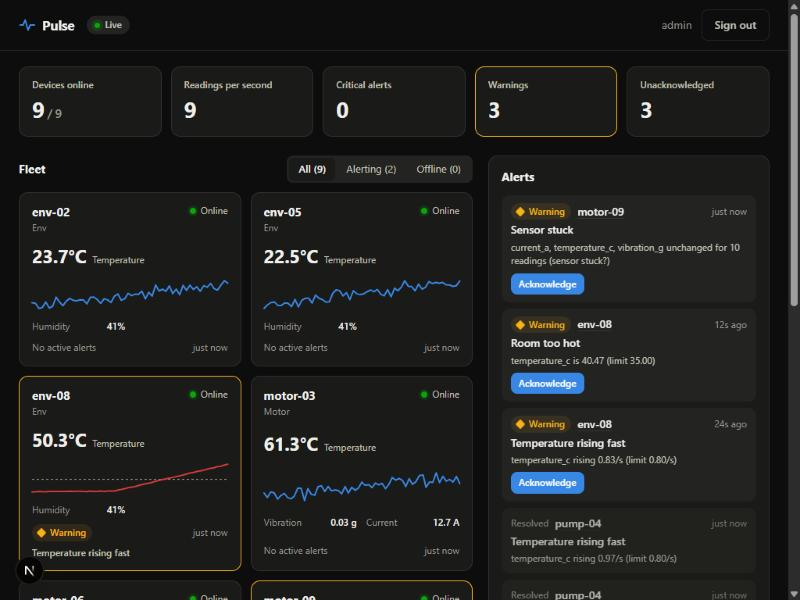
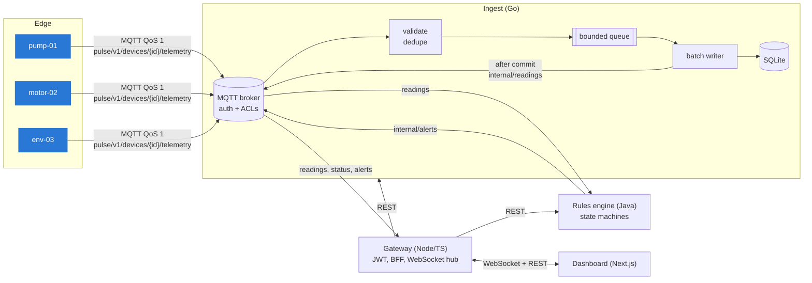

# Pulse

[](https://github.com/StrongMind0/pulse/actions/workflows/ci.yml)

**Real-time IoT telemetry and alerting, from the device firmware to the dashboard.**

Pulse takes sensor data from a fleet of devices, validates and stores it, runs detection rules
against it, and pushes alerts to a live dashboard within a second. Every layer is a separate
service in the language that fits it best, and each was built to keep working when the network,
the broker or a client misbehaves.



| Layer | Tech | What it does |
|---|---|---|
| **Firmware** | C99, zero heap allocation | MQTT 3.1.1 client written from scratch, offline outbox, QoS 1 retransmit, jittered backoff, fault-injecting sensor models |
| **Ingest** | Go, embedded MQTT broker, SQLite | Device auth and topic ACLs, validation, de-duplication, backpressure, batched writes, Prometheus metrics |
| **Rules** | Java 21, Spring Boot 4 | Per-device alert state machines with hysteresis, early warnings on rate of change, stuck-sensor and silent-device detection |
| **Gateway** | Node.js, TypeScript, Fastify | JWT auth, brute-force lockout, backend-for-frontend API, WebSocket fan-out with slow-client protection |
| **Dashboard** | Next.js 16, React 19 | Live fleet view, one chart per metric with alert-limit lines, acknowledgements, keyboard and screen-reader support |
| **Platform** | Docker, Compose, GitHub Actions | Multi-stage non-root images, distroless Go image, CI with sanitizers, race detector and an end-to-end test |

## Architecture



The MQTT broker is the system's message bus. Devices may publish **only** to their own telemetry
topic. Backend services may read the internal topics, and only the rules engine publishes alerts.
Readings are announced downstream **only after they are committed to the database**, so no
consumer ever acts on data that later turns out not to exist.

More detail: [docs/ARCHITECTURE.md](docs/ARCHITECTURE.md) · how it fails and what happens:
[docs/FAILURE_MODES.md](docs/FAILURE_MODES.md) · design decisions: [docs/adr](docs/adr).

## Quick start

You need Node 22+, Go 1.27+, Java 21 and a C compiler (gcc or clang, plus make).

```bash
npm run setup     # install dependencies, build the C simulator
npm run dev       # start everything plus a simulated fleet with injected faults
```

Open **http://localhost:3000** and sign in with the username and password printed in the
terminal (randomly generated into `.env` on first run).

Or run it all in containers:

```bash
cp .env.example .env      # then change the secrets
docker compose up --build
```

### Things to try

- Watch a pump overheat. The **"Temperature rising fast"** warning fires *before* the hard limit
  is reached, then the critical alert fires, then both auto-resolve when the fault clears.
- Click a device to see one chart per metric, with the alert limit drawn as a dashed line.
  Hover, or use the arrow keys, to read exact values. Switch to the table view.
- Stop `npm run dev` with the dashboard open, then start it again: the dashboard shows
  *Reconnecting…*, then resyncs on its own.
- Run the fleet with a flaky network: `firmware/build/pulse-sim --net-chaos 0.05`. Devices
  buffer while disconnected and flush on reconnect, with no lost or duplicated readings
  (`readingCount == lastSeq` for every device).

## Tests

```bash
npm test          # every suite, with a summary
node scripts/smoke.mjs   # end-to-end check against a running stack
```

| Suite | What it proves |
|---|---|
| Firmware, 91 checks | MQTT bytes match the spec tables, packets split across TCP reads, outbox ordering, eviction and retransmit, packet-id wraparound, backoff never overflows. CI also runs it under ASan and UBSan. |
| Ingest | Validation table tests; pipeline batching, load shedding, retry and drain on shutdown; a **real broker with real MQTT clients**: auth rejections, spoofing another device or injecting data as a service gets the client disconnected and the data discarded. CI runs with `-race`. |
| Rules | Hold durations, hysteresis (no flapping), one alert per device and rule, out-of-order handling, silence detection, idempotent acks, 50 devices × 4 threads concurrency, HTTP contract tests |
| Gateway | Forged, expired, wrong-audience and `alg=none` JWTs; brute-force lockout; CORS; acknowledging identity taken from the token, not the request body; slow-client shedding and eviction; WebSocket auth handshake |
| Dashboard | State reducer: snapshot plus live merge, de-duplication, bounded history, stale events never resurrect resolved alerts |
| E2E (CI) | Whole stack in Docker: devices report, readings are queryable, an alert fires and is acknowledged through the gateway |

## Observability

Every service exposes Prometheus metrics: received, rejected (by reason), dropped (by reason)
and persisted readings, queue depth, batch latency, alert events by rule and severity, WebSocket
clients and shed messages, upstream errors, and login failures. Ingest has a `/readyz` that
turns unhealthy when its queue is 90% full, so a load balancer can stop sending it devices
before it starts shedding data.

## Roadmap

- **Phase 2:** Android (Kotlin, Compose) and iOS (SwiftUI) alert apps with push notifications;
  ESP32 firmware build using the same C core
- **Phase 3:** Kubernetes and Helm, Terraform, Grafana dashboards, k6 load tests with published
  throughput and latency numbers
- **Phase 4:** per-device mTLS certificates, a threat model, CodeQL, image scanning and an SBOM

## Repository layout

```
firmware/              C core library (MQTT, outbox, backoff, sensors), host simulator, tests
services/ingest-go/    MQTT broker, validation, storage, HTTP API
services/rules-java/   rules engine, alert lifecycle, REST API
services/gateway-node/ auth, BFF API, WebSocket hub
web/                   Next.js dashboard
scripts/               one-command dev runner, setup, test runner, smoke test
docs/                  architecture, failure modes, ADRs
```
